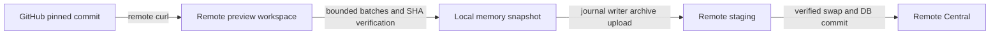

# Verification and outcome

## Root cause
GitHub remote confirmation reconstructed a local byte snapshot using one sequential SSH read per selected file, then the durable writer uploaded those bytes back to the target. The serial read loop magnified per-process/network latency. It accepted equal-length altered bytes without matching the confirmed SHA. Marketplace additionally acquired a local snapshot before a separate remote acquisition.

## Implemented behavior
- GitHub selected payload reads: bounded batches of 64 files / 32 MiB using supervised binary transport; no extra remote package dependency.
- Reuse registered/pinned manifest, eliminate the second inventory, compare byte length and SHA before Central creation and journal writes.
- Marketplace SSH/WSL: acquire one remote pinned preview, select from it, import the same token, discard on terminal paths. No initial local content acquisition.
- Durable journal, UID preservation, target isolation and local import behavior retained.

## Before/after measurement (SIMULATED latency)
Fixture: 128 files, 512 content bytes, each transport call sleeps 10 ms through an injectable runner. Windows timer scheduling affects the observed wall time. Both paths return identical bytes.

| Metric | Legacy selected read loop | Bounded batch reader |
| --- | ---: | ---: |
| Payload-read process calls | 128 | 2 |
| Measured wall time | 1,986.94 ms | 30.77 ms |
| Content bytes returned | 512 | 512 |

This measures only selected-content readback with synthetic delay, not the complete import or real SSH throughput. Transport script bytes and journal uploads are not included in the content-byte count. The implementation also removes one repeated inventory call on preview imports.

## Validation evidence
- `just doctor`: PASS (Node 26.7.0, Rust 1.98.0, pnpm 12.18.0).
- Focused batch suite: 6 passed, 1 optional shell smoke ignored in default run.
- `SKILLPORT_TEST_POSIX_SHELL=C:\Program Files\Git\bin\bash.exe` + `cargo test --locked services::github_import::remote -- --include-ignored --nocapture`: 8 passed. Includes real supervised shell execution and full workspace-import tamper/no-mutation test with positive control.
- Typecheck: PASS. Actual package lint: PASS (`rtk bypass pnpm lint`). Normal interactive `pnpm lint` was rewritten by RTK into a broader scan and reported unrelated archive JS; bypass proved the actual src-only script passes. No lint policy changes made.
- Independent Trellis check found no production correctness defect; added the full importer regression test.
- `just ci`: PASS, exit 0. Includes 2,346 frontend tests; Rust 1,742 passed across unit/integration binaries (12 opt-in/helper tests ignored); Clippy, formatting, IPC/generated docs, frontend and documentation builds. Trellis Python: 54 run, 4 platform-inapplicable skips, OK.

## Limits and deferred findings
- No live user SSH host/native desktop import or installed Windows bundle was exercised. No credentials or production remote files were changed.
- Bytes still travel remote -> local RAM -> remote journal stage. This change targets repeated round-trip cost and redundant acquisition, not complete elimination of relay bandwidth.
- Remote preview still downloads a full repository archive; candidate metadata discovery still uses individual reads; journal operations remain per-skill.
- Marketplace lifecycle routing is structurally tested, but actual HTTP auth fallback and SSH cleanup-failure execution are not integration-tested.
- Archive budget enforcement after download/extraction and optional plugin metadata reads treating errors as absent are existing separate risks, not changed here.
- User authorized committing all changes and archiving this task after validation. No remote Git writes or release actions.

## Current data path

The initial repository archive is not downloaded to the user's local disk by this GitHub SSH path. Local HTTP still resolves repository metadata and commit identity. The selected file payload is deliberately retained in local memory for the shared durable writer.

## Skipped evidence in default CI
Rust skips retain existing explicit opt-in policies: live WSL delete/restore and batch benchmark, clear-all/pagination/update/usage performance benchmarks, pinned-snapshot source probe, isolated-home scanner sanity, and subprocess fixture entrypoint. The new local POSIX shell test is also ignored by default, but was explicitly executed successfully in this task. Python skipped four POSIX-only symlink cases on Windows. No real SSH or installer acceptance is inferred from these results.

## Completion
Implementation, independent review and repository gate are complete. The user authorized committing all changes and archiving this task. Work, archive and journal commits follow the Trellis completion flow; no push or release is authorized.
